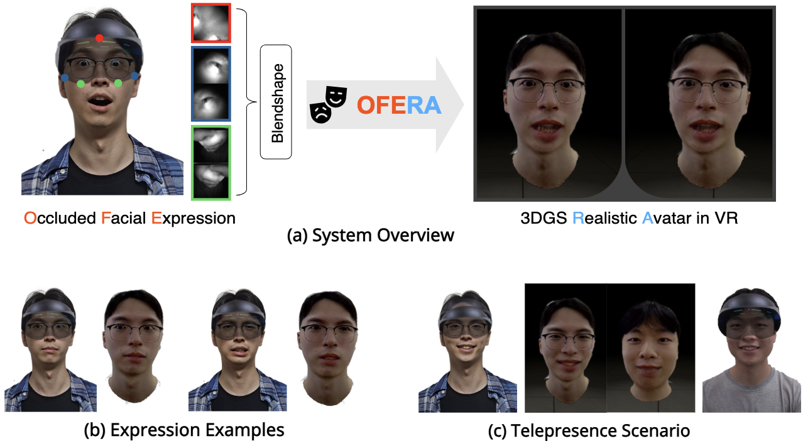

# OFERA: Blendshape-driven 3D Gaussian Control for Occluded Facial Expression to Realistic Avatars in VR

[Project Page](https://ysshwan147.github.io/projects/ofera/) | [Paper](https://arxiv.org/abs/2602.01748)



## Overview

This is the official repository for the paper **"OFERA: Blendshape-driven 3D Gaussian Control for Occluded Facial Expression to Realistic Avatars in VR."**

---

## Training

TBD

---

## Running Inference

### Environment Setup

#### Tested Environment

The following configuration is the environment we have tested so far for inference. Additional tested environments may be added later.

| Component | Tested Version |
|--------|----------|
| OS | Windows 11 |
| GPU | NVIDIA GeForce RTX 4090 |
| CUDA | 11.8 |
| PyTorch | 2.6 |
| PyTorch3D | 0.7.8 |

#### Clone the repository

```bash
git clone --recursive https://github.com/ysshwan147/OFERA.git
```

#### Conda Environment

```bash
conda create -n ofera python=3.10
conda activate ofera
```

#### Install Dependencies

```bash
pip install -r requirements.txt

pip install torch==2.6.0 torchvision==0.21.0 torchaudio==2.6.0 --index-url https://download.pytorch.org/whl/cu118

pip install --extra-index-url https://miropsota.github.io/torch_packages_builder pytorch3d==0.7.8+pt2.6.0cu118
```


#### simple-knn

```bash
# Run in Native Tools Command Prompt for VS 2019
set DISTUTILS_USE_SDK=1
set TORCH_CUDA_ARCH_LIST=8.9
set FORCE_CUDA=1
set CUDAFLAGS=--use_fast_math
set CXXFLAGS=/O2

git clone --recursive https://github.com/camenduru/simple-knn.git
cd simple-knn
python -m pip install -v --no-build-isolation --no-cache-dir -e .
```

After installation, edit `simple-knn/simple_knn/__init__.py` and add:

```python
from . import _C
```

#### diff-gaussian-rasterization

```bash
# Run in Native Tools Command Prompt for VS 2019
set DISTUTILS_USE_SDK=1
set TORCH_CUDA_ARCH_LIST=8.9
set FORCE_CUDA=1
set CUDAFLAGS=--use_fast_math
set CXXFLAGS=/O2

git clone https://github.com/graphdeco-inria/diff-gaussian-rasterization.git --recursive
cd diff-gaussian-rasterization
python -m pip install -v --no-build-isolation --no-cache-dir -e .
```

---

### Weights

Two sets of weights are required for running inference:

#### FateAvatar Weights

Please prepare the required pretrained weights for FateAvatar under `FateAvatar/weights` by following the official FateAvatar installation guide:

[FateAvatar Installation Guide](https://github.com/zjwfufu/FateAvatar/tree/main?tab=readme-ov-file#installation)

#### Mapping Matrix

Please prepare the required predefined matrix for baseline under `weights/`

[PantoMatrix(EMAGE) Repository](https://github.com/PantoMatrix/PantoMatrix?tab=readme-ov-file#2-models-and-tools-list)

#### OFERA Weights

Please place the pretrained OFERA weights under `weights/`.

Download link:

[Google Drive Placeholder](https://drive.google.com/file/d/175jf1luYUYzwZ4Pb13N-UZxc1q8TeSqO/view?usp=sharing)

---

### Unity Setup

- **Tested Unity Version**: 2021.3.45f1
- **Project Path**: `/Unity/OFERA`

#### VR Viewer

We use a modified version of `GaussianSplattingVRViewerUnity` to render 3D Gaussian Splatting in a VR environment.  
To support dynamic Gaussian updates based on streamed expression values, we forked and modified the original repository.

Clone the customized repository:

```bash
git clone -b OFERA https://github.com/ysshwan147/GaussianSplattingVRViewerUnity.git
```

#### Plugin Setup

Copy the plugin directory below into the Unity project:

```text
GaussianSplattingVRViewer/Assets/GaussianSplattingPlugin
→ Unity/OFERA/Assets/
```

#### Retargeting Configuration

Hierarchy:

```text
MirroredObjects/
  BlendshapeMappingExampleARKIT_A2E - Mirrored/
    FaceRetargeter
```

Retargeter config:

```text
arkit_retarget_a2e_v10
```

Add the following pairs:

```json
"EyesLookUpL": {
  "eyeLookUpLeft": 1.0
},
"EyesLookUpR": {
  "eyeLookUpRight": 1.0
},
"EyesLookDownL": {
  "eyeLookDownLeft": 1.0
},
"EyesLookDownR": {
  "eyeLookDownRight": 1.0
},
"EyesLookLeftL": {
  "eyeLookOutLeft": 1.0
},
"EyesLookLeftR": {
  "eyeLookInRight": 1.0
},
"EyesLookRightL": {
  "eyeLookInLeft": 1.0
},
"EyesLookRightR": {
  "eyeLookOutRight": 1.0
}
```

---

### Inference

#### Step 1. Start the Server

```bash
python server.py
```

#### Step 2. Connect the VR Headset

- Execute **Quest Link**
- Open the Unity project
- Turn **Play** on in Unity

#### Step 3. Runtime Controls

| Button | Function |
|--------|----------|
| 1 | Matrix-based mapping |
| 2 | Linear-based mapping |
| 3 | Without BDA |
| 4 | Without MiA |
| 5 | Ours |
| T | Expression active |
| F | Expression deactive |

---

## Acknowledgements

This project builds on several excellent prior works and open-source repositories:

- [3DGS](https://github.com/graphdeco-inria/gaussian-splatting)
- [FateAvatar](https://github.com/zjwfufu/FateAvatar)
- [GaussianSplattingVRViewerUnity](https://github.com/clarte53/GaussianSplattingVRViewerUnity)
- [mediapipe-blendshapes-to-flame](https://github.com/PeizhiYan/mediapipe-blendshapes-to-flame)
- [EMAGE (matrix-based ARKit to FLAME mapping)](https://github.com/PantoMatrix/PantoMatrix)

---

## Citation

If you find this repository useful, please consider citing our paper:

```bibtex
@article{yang2026ofera,
  title={OFERA: Blendshape-driven 3D Gaussian Control for Occluded Facial Expression to Realistic Avatars in VR},
  author={Yang, Seokhwan and Yoon, Boram and Kang, Seoyoung and Song, Hail and Woo, Woontack},
  journal={arXiv preprint arXiv:2602.01748},
  year={2026}
}
```

---

## License

The original OFERA code in this repository is released under the [MIT License](LICENSE).

Third-party code, submodules, and external projects referenced by this repository remain under their respective licenses and terms. Please see [THIRD_PARTY_NOTICES.md](THIRD_PARTY_NOTICES.md) for details.
